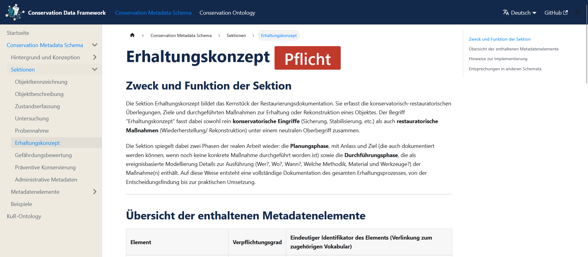
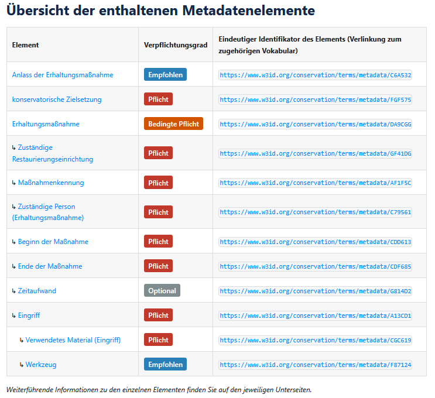
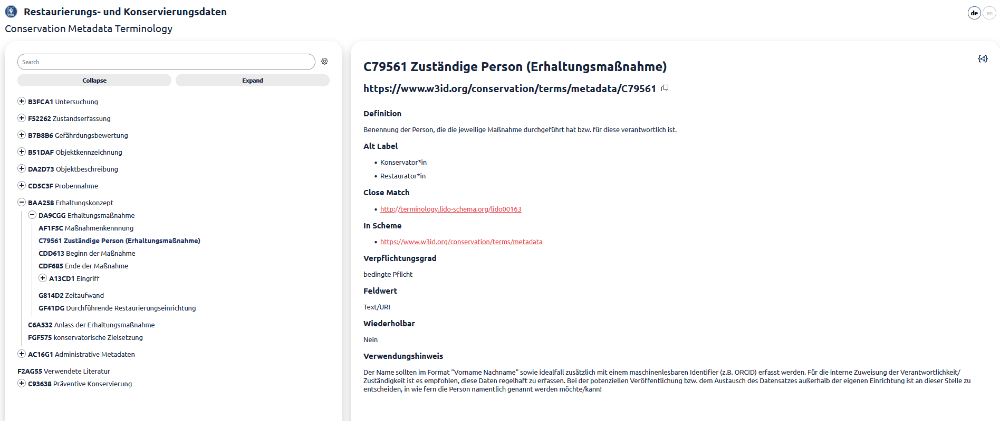

<!--
author: Canan Hastik und Gudrun Schwenk
email: soda@sammlungen.io

title: SODa BeratungsCamp - Einheit 1
version: v1.0.0
language: DE

icon: https://raw.githubusercontent.com/soda-collections-objects-data-literacy/SODaBeratungsCamp_Modul2/refs/heads/main/assets/SODa-Logo_full.svg

link: https://raw.githubusercontent.com/soda-collections-objects-data-literacy/SODaBeratungsCamp_Modul2/refs/heads/main/soda.css

comment: Dieses Modul [Text ergänzen]

-->

# SODa BeratungsCamp 

**Modul 2: Analyse und Strukturierung von Konservierungs- und Restaurierungsdaten am Beispiel medienarchäologischer Erschließung**

Einheit 1: **Das KuR-MDS als Werkzeug zur Strukturierung von Konservierungs- und Restaurierungsdaten**  

**Dauer:** ~ 10 Min.

---

## Lernziele

Lernende können...

1\.1 den Begriff Metadaten erläutern. (LZ-ID 03\_02\_0626)

1\.2 verschiedene Arten von Metadaten benennen. (LZ-ID 03\_02\_0627)

1\.3 die Relevanz von Metadaten benennen und erläutern. (LZ-ID 03\_02\_0628 & LZ-ID 03\_02\_0629)

1\.4 die Relevanz von Metadaten in der Konservierungs- und Restaurierungsdokumentation benennen (LZ-ID SODa\_03\_002\_0628a)

1\.5 die Relevanz von Metadaten in der Konservierungs- und Restaurierungsdokumentation erläutern. (LZ-ID SODa\_03\_002\_0629a)

1\.6 den Begriff Metadatenschema erläutern (LZ-ID SODa\_03\_003\_0675)

1\.7 die Relevanz von Metadatenschemata in der Konservierungs- und Restaurierungsdokumentation benennen. (LZ-ID SODa\_03\_003\_0676)

1\.8 die Relevanz von Metadatenschemata in der Konservierungs- und Restaurierungsdokumentation erläutern. (LZ-ID SODa\_03\_003\_0677)

1\.9 ein Metadatenschema für die Dokumentation von Konservierungs- und Restaurierungsmaßnahmen (KuR-MDS) benennen. (LZ-ID SODa\_03\_003\_0678)

1\.10 ein Metadatenschema für die Dokumentation von Konservierungs- und Restaurierungsmaßnahmen (KuR-MDS) erläutern. (LZ-ID SODa\_03\_003\_0679)

1\.11 Thesauri zur Beschreibung von Konservierungs- und Restaurierungsmaßnahmen benennen. (LZ-ID SODa\_03\_006\_0752a)

---

## Voraussetzung

*keine*

---

## 1.1 Was sind Metadaten und Metadatenschemata

Es gibt zahlreiche **Definitionen:**

„Metadaten sind strukturierte Daten, die Informationen über andere Daten beinhalten – Daten über Daten.“ [1]

„Metadaten beinhalten strukturierte Informationen über Daten (z.B. Forschungsdaten) oder andere Ressourcen und deren Merkmale. Sie werden entweder unabhängig von oder zusammen mit den Daten, die sie beschreiben, abgespeichert.“ [2]

Metadaten „enthalten strukturierte Informationen über Daten, Objekte oder andere Ressourcen und machen diese identifizierbar, auffindbar und interpretierbar.“ [3]

Im Forschungsdatenmanagement werden **verschiedene Arten von Metadaten** unterschieden: [3] [4]

- **Deskriptive/Bibliografische Metadaten** beschreiben ein Objekt und seinen Kontext und dienen der Zietierbarkeit und Auffindbarkeit.

- **Administrative Metadaten** regeln organisatorische, rechtliche oder technische Rahmenbedingungen und sind für die Verwaltung und langfristige Aufbewahrung der Daten notwendig.

- **Technische Metadaten** beschreiben die digitale Datei, nicht das Objekt selbst und werden in der Regel automatisch generiert.

- **Strukturelle Metadaten** beschreiben, die Datenstruktur und wie einzelne Informationen verknüpft sind.

„Ein **Metadatenschema** "ist eine Sammlung von Metadaten-Elementen und Eigenschaften, mit denen Objekte und deren Beziehungen zueinander strukturiert beschrieben und verarbeitet werden können." [5] Es "legt fest, welche Informationen zu einem Objekt oder einer Ressource erfasst werden, wie diese Informationen benannt werden und welche Felder verpflichtend oder wiederholbar sind.“ [3]

Unterschieden werden hierbei das **Erfassungsformat, das Speicherformat und das Austauschformat**. [6]

---

## 1.2 Relevanz von Metadaten und Metadatenschemata in der Konservierungs- und Restaurierungsdokumentation

Die Konservierungs- und Restaurierungsdokumentation (KuR) umfasst **heterogene Informationen und Daten**, die in **unterschiedlichen Formen, Datentypen, Dateiformaten und Quellen** vorliegen, da sie in der Regel in **unterschiedlichen fachlichen Zusammenhängen** entstehen. So können etwa schriftliche Restaurierungsberichte, Fotografien, Röntgenaufnahmen, Messdaten, Zeichnugnen, Programmcode, Anleitungen, technische Spezifikationen uvm. Bestandteil einer KuR-Dokumentation sein. 

Damit die unterschiedlichen Informationen über ihren ursprünglichen Dokumentationszusammenhang hinaus **auffindbar**, miteinander **verknüpfbar** und **nachnutzbar** werden, bedarf es einer **nachvollziehbaren und systematischen Strukturierung**.

- **Metadaten** ermöglichen es, solche Informationen zu beschreiben, zu kontextualisieren und gezielt auffindbar zu machen.

- **Metadatenschemata** schaffen dafür eine gemeinsame fachliche Struktur, indem sie Regeln festlegen, welche Informationen erfasst und definieren, wie sie einheitlich beschrieben werden können.

---

## 1.3 Das Metadatenschema für die Dokumentation von Konservierungs- und Restaurierungsmaßnahmen (KuR-MDS)

Das **Metadatenschema für die Dokumentation von Konservierungs- und Restaurierungsmaßnahmen (KuR-MDS)** wurde von den Mitgliedern der **NFDI4Objects-TWG "Community-Standards für kontrollierte Vokabulare und Austauschformate im Bereich der Erhaltung und Pflege des kulturellen Erbens"** [7] in einem iterativen Prozess und unter enger Rückbindung an die Fachcommunity entwickelt. [8] 

---

## 1.4 Aufbau und grundlegende Begriffe des KuR-MDS

Das KuR-MDS besitzt eine **modulare Struktur** und ermöglicht eine bedarfsgerechte KuR-Dokumentation. [9]

Die zu konservierenden und restaurierenden Objekte stammen aus unterschiedlichen kulturellen und historischen Kontexten und unterscheiden sich in Material, Funktion, Erhaltungszustand und -anforderungen. 

Objekte werden häufig nur partiell und im Rahmen konkreter Ausstellungs-, Forschungs- oder anderer Vorhaben bearbeitet. 

Die KuR-Prozesse und ihre Dokumentationen sind daher sehr unterschiedlich und umfassen nicht immer alle Aspekte des Restaurierungsprozesses.

## 1.5 Die Sektionen

Der KuR-MDS strukturiert die grundlegenden "Prozesse im Umgang mit Kunst- und Kulturgut im Kontext konservatorisch-restauratorischer Arbeiten" in **zehn übergeordnete Kategorien**, die als **Sektionen** bezeichnet werden. [9] 

Den einzelnen Sektionen sind Metadatenelemente zugeordnet, die den entsprechenden KuR-Prozess beschreiben.

Für die einzelnen **Sektionen** und den zugehörigen spezifischen **KuR-Metadatenelementen** sind **Verpflichtungsgrade** zugeordnet. Ingesgesamt gibt es **vier Verpflichtungsgrade**: [9]

  - **Pflicht:** "Umfasst jene Informationen, ohne die eine vollständige und für Dritte nachvollziehbare Dokumentation nicht möglich ist." [9]
    
  - **Bedingte Pflicht:** "Bezeichnet Elemente, die nur unter bestimmten Umständen verpflichtend auszufüllen sind, z.b. nur wenn eine bestimmte Tätigkeit durchgeführt wurde." Der Verpflichtungsgrad adressiert Informationen, "die grundsätzlich für eine qualitätvolle Dokumentation erwartet werden (die also über eine bloße Empfehlung hinausgehen), in der realen Praxis jedoch zum Zeitpunkt der Erfassung häufig nicht (mehr) verfügbar sind. (z.B. bei der Retrodigitalisierung analoger Berichte)." [9]
    
  - **Empfohlen:** "Bezieht sich auf Informationen, die aus fachlicher Sicht als wünschenswert deklariert werden. Ihre Erfassung verbessert die Qualität und Nachnutzbarkeit der Dokumentation erheblich, ohne dass ihr Fehlen das grundlegende Verständnis der konservatorisch-restauratorischen Dokumentation beeinträchtigt." [9]
    
  - **Optional:** "Dient der Erweiterung des Schemas für spezifische Fachdisziplinen oder besondere Arbeitskontexte. Diese Elemente zeigen exemplarisch auf, wie das Schema kontextspezifisch ausgebaut werden kann." [9]
  

Sowohl die Sektionen als auch die KuR-Metadatenelemente sind in der [**Conservation Metadata Terminology**](https://conservationdata.github.io/terms/metadata.html) definiert. Die Definitionen umfassen unter anderem folgende Angaben: **Begriffsdefinition, Verpflichtungsgrad, Feldwert, Wiederholbarkeit, Verwendungshinweis sowie eine eindeutige URI**. [10] [11]

> **Hinweis:**  
> 
> Detallierte Informationen zu Hintergrund, fachlichem und konzeptuellen Rahmen sowie Nachnutzung des KuR-MDS bietet das [NFDI4Objects Conservation Data Framework Online-Portal](https://nfdi4objects.github.io/n4o_conservation_data_framework/) (im Folgenden **CDF**). Die dort bereitgestellte Dokumentation umfasst eine detaillierte Beschreibung von Zweck und Funktion der einzelnen Sektionen sowie einen Überblick über die und eine Beschreibung der in den jeweiligen Sektionen enthaltenen Metadatenelemente, den Verpflichtungsgrad und die dazugehörigen URIs. Die im Conservation Data Framework bereitgestellten Inhalte stehen unter der CC BY 4.0-Lizenz und können unter Angabe der Quelle frei nachgenutzt werden. [12]

---

## 1.6 Überblick über die Sektionen

> Die folgende Tabelle zeigt die 10 thematischen Sektionen des KuR-MDS mit den entsprechenden Verpflichtungsgraden und URIs aus der Conservation Metadata Terminology.

| Sektionen | Verpflichtungsgrad | URI (Conservation Metadata Terminology) |
|--------|--------|------|
| Objektkennzeichnung | Pflicht | https://www.w3id.org/conservation/terms/metadata/B51DAF |
| Objektbeschreibung | Pflicht | https://www.w3id.org/conservation/terms/metadata/DA2D73 |
| Zustandserfassung | Pflicht | https://www.w3id.org/conservation/terms/metadata/F52262 |
| Untersuchung | Bedingte Pflicht | https://www.w3id.org/conservation/terms/metadata/B3FCA1 |
| Probenahme | Bedingte Pflicht | https://www.w3id.org/conservation/terms/metadata/CD5C3 |
| Erhaltungskonzept | Pflicht | https://www.w3id.org/conservation/terms/metadata/BAA258 |
| Gefährdungsbewertung | Bedingte Pflicht | https://www.w3id.org/conservation/terms/metadata/BAA258 |
| Präventive Konservierung | Empfohlen | https://www.w3id.org/conservation/terms/metadata/C93638 |
| Administrative Metadaten | Pflicht | https://www.w3id.org/conservation/terms/metadata/AC16G1 |
| Verwendete Literatur | Optional | https://www.w3id.org/conservation/terms/metadata/F2AG55 |

> Quellen: [Die thematischen Sektionen des KuR-MDS](https://nfdi4objects.github.io/n4o_conservation_data_framework/conservation-metadataschema/sections/) [9] & [Conservation Metadata Terminology](https://conservationdata.github.io/terms/metadata.html) [10]

---

## 1.7 Beispiel: Sektion Erhaltungskonzept

**Folgende Inhalte:**

- Zweck und Funktion der Sektion Erhaltungskonzept (KuR-MDS Beschreibungstext)
- Metadaten der Sektion Erhaltungskonzept (KuR-MDS Beschreibungstext)
- Definition des Metadatums "Zuständige Person" in der Conservation Metadata Terminology

### Zweck und Funktion der Sektion Erhaltungskonzept (KuR-MDS Beschreibungstext)

> Der Screenshot aus Abbildung 1 zeigt exemplarisch anhand der **Sektion Erhaltungskonzept**, wie die einzelnen Sektionen des KuR-MDS im CDF beschrieben werden. Zu sehen ist nur ein Ausschnitt des Beschreibungstextes. Die Beschreibung beinhaltet darüber hinaus eine Übersicht der enthaltenen Metadatenelemente sowie Hinweise zur Implementierung und Entsprechungen in anderen Schemata.

>**Abbildung 1:** Beschreibung von [Zweck und Funktion der Sektion Erhaltungskonzept](https://nfdi4objects.github.io/n4o_conservation_data_framework/conservation-metadataschema/sections/conservation-plan/) aus dem KuR-MDS. Screenshot (Ausschnitt) aus: KuR-MDS | CDF (CC BY 4.0) (Stand: 26.11.2026) [13]

---

### Metadaten der Sektion Erhaltungskonzept (KuR-MDS Beschreibungstext)

> Der Screenshot aus Abbildung 2 zeigt exemplarisch anhand der **Sektion Erhaltungskonzept**, wie die einzelnen Metadatenelemente einer Sektion des KuR-MDS im CDF mit jeweiligen Verpflichtungsgraden und eindeutigen URIs aus der Conservation Metadata Terminology [10] hierarchisch aufgeführt werden.

>**Abbildung 2:** Überblick über die [Metadatenelemente der Sektion Erhaltungskonzept](https://nfdi4objects.github.io/n4o_conservation_data_framework/conservation-metadataschema/sections/conservation-plan/) aus dem KuR-MDS. Screenshot aus: KuR-MDS | CDF (CC BY 4.0) (Stand: 26.11.2026) [13] 

---

### Definition des Metadatums "Zuständige Person" in der Conservation Metadata Terminology

> Der Screenshot aus Abbildung 3 zeigt exemplarisch anhand des Metadatums "Zuständige Person" der KuR-MDS Sektion Erhaltungskonzept, wie Definitionen von Metadaten in der Conservation Metadata Terminology [10] aufgebaut sind und welche Informationen sie umfassen.

>**Abbildung 3:** Terminus ["C79561 Zuständige Person (Erhaltungsmaßnahme)"](https://conservationdata.github.io/terms/metadata/C79561.html) aus der Conservation Metadata Terminology. Screenshot aus: Conservation Metadata Terminology (CC BY 4.0) (Stand: 26.11.2026) [14]

---

## 1.8 Weiterführende Hinweise und Linksammlung

> *Stand: 26.11.2026*

**NFDI4Objects Conservation Data Framework Online-Portal (CDF):**

- **Github-Repositorium:** https://github.com/nfdi4objects/n4o_conservation_data_framework
  
- **Online-Portal:**

  - **Online-Präsenz:** https://nfdi4objects.github.io/n4o_conservation_data_framework/
    
  - **Projektseite:** https://www.nfdi4objects.net/services/conservation-data-framework/

---

**Conservation Metadata Terminology:** https://conservationdata.github.io/terms/metadata.html

---

**Mockup-App für Konservierungsdaten:** https://conservationdata.github.io/docu/#/ [15]

Beispielhafte Eingabemaske zur Erfassung von Konservierungs- und Restaurierungsdaten auf Basis des KuR-MDS. 

---

> **Hinweis:**  
> Die Angebote wurden innerhalb der Temporary Working Group Community-Standards für kontrollierte Vokabulare und Austauschformate im Bereich der Erhaltung und Pflege des kulturellen Erbes innerhalb des Konsortiums NFDI4Objects entwickelt. [7]

---

## Quellenangaben

[1] Biernacka, K., Dockhorn, R., Engelhardt, C., Helbig, K., Jacob, J., Kalová, T., Karsten, A., Meier, K., Mühlichen, A., Neumann, J., Petersen, B., Slowig, B., Trautwein-Bruns, U., Wilbrandt, J., & Wiljes,
C. (2023). Train-the-Trainer-Konzept zum Thema Forschungsdatenmanagement (Version 5). Zenodo. https://doi.org/10.5281/ZENODO.10122153

[2] Kommunikations-, Informations-, Medienzentrum (KIM) der Uni Konstanz. (2026). Metadaten. In Forschungsdaten.info: Praxis kompakt Glossar. https://forschungsdaten.info/praxis-kompakt/glossar/#c269911 (Stand: 17.03.2026)

[3] Zöllner, G., & Reichert, R. (2026). Selbstlernkurs: Einführung in die Digitale Provenienzforschung (Version v1.0) [Computer software]. Zenodo. https://doi.org/10.5281/zenodo.22296350

[4] Stegemann, J., Yildiz, C., Blümm, M., Bock, S., Fritsch, K., Kaiser, K. & Rathmann, T. (2024). Arten von Metadaten. In *Schluss mit dem Datenchaos – Wie Forschungsdatenmanagement für Ordnung sorgt* (Version 1.0) [Lernbaustein, FDM@Studium.nrw Selbstlernkurs]. ORCA.nrw. https://www.orca.nrw/moodle/mod/page/view.php?id=22320 (Stand: 24.11.2026)

[5] Petersen, B., Altemeier, F., Boße, S., Dalby, M., Düvel, N., Engelhardt, C., Fichtner, M., Hastik, C., Haugwitz, J.-M., Jacob, J., Koch, K., Kuntz, A., Manske, A., Mühlichen, A., Murcia Serra, J., Ortmeyer, J., Richter, M., Schranzhofer, H., Slowig, B., … Zollitsch, L. (2025). Glossar zur Lernzielmatrix zum Themenbereich Forschungsdatenmanagement (FDM) (Version 3) [Working Paper]. Zenodo. https://doi.org/10.5281/zenodo.15025246

[6] Rühle, S. (2019). Metadaten. In *Kleines Handbuch Metadaten.* https://wiki.dnb.de/download/attachments/43523047/201209_metadaten.pdf (Stand: 24.11.2026)

[7] Fella, K., Lefeldt, J., Mempel-Länger, L., Puhl, A., & Witt, N. (2024). Community-Standards für kontrollierte Vokabulare und Austauschformate im Bereich der Erhaltung und Pflege des kulturellen Erbes. Zenodo. https://doi.org/10.5281/zenodo.14135529

[8] Fischer, K., & Witt, N. (2026). Bericht zum Metadatenschema für die Dokumentation von Konservierungs- und Restaurierungsmaßnahmen (Version v.1). Zenodo. https://doi.org/10.5281/zenodo.22871824

[9] NFDI4Objects. (o. D.). Die thematischen Sektionen des KuR-Metadatenschemas. Conservation Metadata Schema. Conservation Data Framework Online-Portal. https://nfdi4objects.github.io/n4o_conservation_data_framework/conservation-metadataschema/sections/ (Stand: 25.11.2026)

[10] TWG Community-Standards für kontrollierte Vokabulare und Austauschformate im Bereich der Erhaltung und Pflege des kulturellen Erbes. (o. D.). Conservation Metadata Terminology [Kontrolliertes Vokabular]. Restaurierungs- und Konservierungsdaten. https://conservationdata.github.io/terms/metadata.html (Stand: 24.11.2026)

[11] Hagel, F. v. (2025). Konservierung/Restaurierung (Metadatenvokabular). https://museumsvokabular.de/metadatenvokabular-konservierung-restaurierung/ (Stand: 25.11.2026)

[12] NFDI4Objects. (o. D.). NFDI4Objects Conservation Data Framework Online-Portal. https://nfdi4objects.github.io/n4o_conservation_data_framework/ (Stand: 24.11.2026)

[13] NFDI4Objects. (o. D.). Erhaltungskonzept. Conservation Metadata Schema. Conservation Data Framework Online-Portal. https://nfdi4objects.github.io/n4o_conservation_data_framework/conservation-metadataschema/sections/conservation-plan (Stand: 25.11.2026)

[14] TWG Community-Standards für kontrollierte Vokabulare und Austauschformate im Bereich der Erhaltung und Pflege des kulturellen Erbes. (o. D.). Terminus "C79561 Zuständige Person (Erhaltungsmaßnahme)". Conservation Metadata Terminology [Kontrolliertes Vokabular]. Restaurierungs- und Konservierungsdaten. https://conservationdata.github.io/terms/metadata/C79561.html (Stand: 26.11.2026)

[15] Mempel-Länger, L., Fischer, K., & Witt, N. (2025). Conservation Documentation Data [Webanwendung]. https://conservationdata.github.io/docu/#/ (Stand: 26.11.2026)

### Metadaten

author: Canan Hastik

orcid: https://orcid.org/0000-0003-1729-4642

email: c.hastik@igsd-ev.de

author: Gudrun Schwenk

orcid: https://orcid.org/0009-0002-3156-8339

email: g.schwenk@igsd-ev.de

sessiontitle: Analyse und Strukturierung von Konservierungs- und Restaurierungsdaten am Beispiel medienarchäologischer Erschließung

sessionnumber: 2

unittitle: Das KuR-MDS als Werkzeug zur Strukturierung von Konservierungs- und Restaurierungsdaten

unitnumber: 1

duration unit: 10 Minuten (PT0H10M)

rights: CC-BY 4.0

rights description: Dieses Material steht unter der Lizenz Creative Commons Attribution 4.0 International.

rights link: https://creativecommons.org/licenses/by/4.0/

SODaformat: SODa Workshop, SODa Train-the-Trainer

SODagestaltungsprinzip: Forschendes Lernen

classification: Forschende, Sammlungsleitende und -betreuende. Technisches admin Personal, Hilfskräfte, Interessierte

classification description: basierend auf SODaPersonas-Beschreibungen, Reichert R., Hastik, C., Gnyp, A., Markert, M., & Tharandt, L. (2025). SODa Personas. Zenodo. https://doi.org/10.5281/zenodo.15574575

mediatype: Text

technical format: Markdown mit LiaScript-Erweiterungen

file format: .md | MIME: text/markdown

software: LiaScript

runtime environment: https://liascript.github.io

keywords: sammlungsbezogenes Forschungsdatenmanagement; Konservierung; Restaurierung; Dokumentation

references: 
