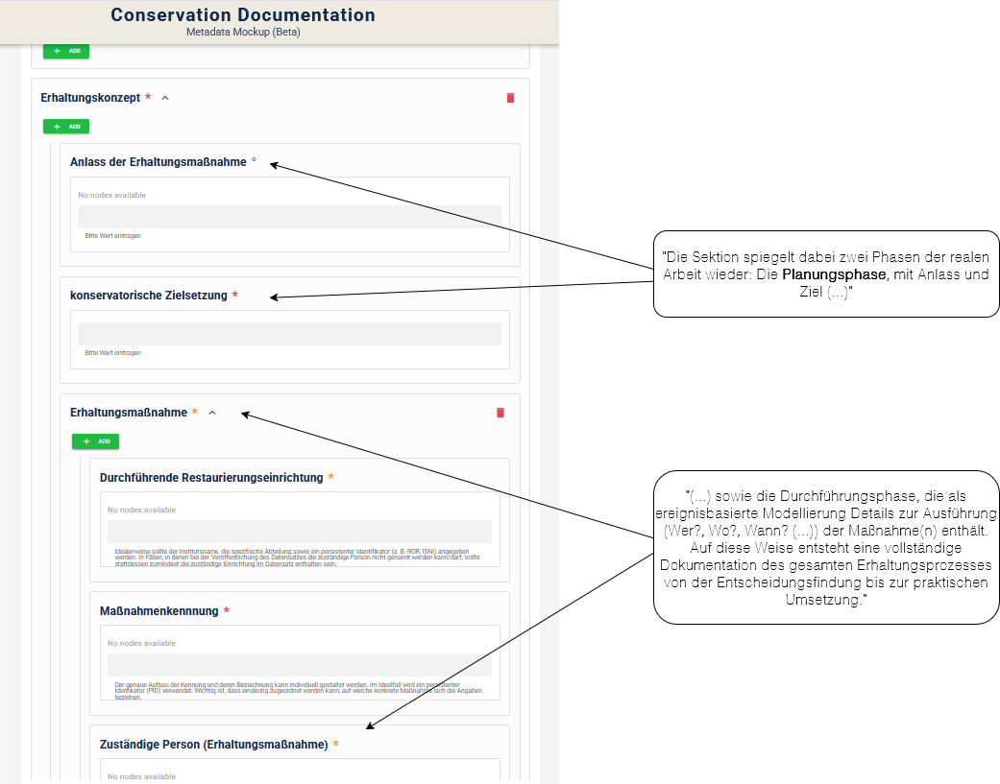
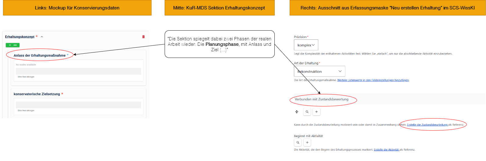
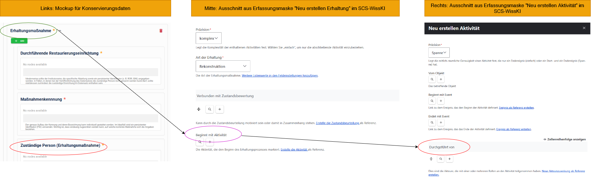

<!--
author: Canan Hastik und Gudrun Schwenk
email: soda@sammlungen.io

title: SODa BeratungsCamp - Einheit 1
version: v1.0.0
language: DE

icon:     https://raw.githubusercontent.com/chastik/Beratung_Dateityp_Bild/refs/heads/main/SODa-Logo_full.svg
link:     https://raw.githubusercontent.com/soda-collections-objects-data-literacy/SODaBeratungsCamp_Modul1/refs/heads/main/soda.css
          https://fonts.googleapis.com/css?family=Noto+Sans

comment: Dieses Modul [Text ergänzen]
-->

# SODa BeratungsCamp 

**Modul 2: Analyse und Strukturierung von Konservierungs- und Restaurierungsdaten am Beispiel medienarchäologischer Erschließung**  

Einheit 3: **Modellierung und Erfassung in WissKI/SCS als graphbasierte Datenstruktur**  

**Dauer:** ~ 40 Min.

---

## Lernziele

Lernende können...

- für das sammlungsbezogene Forschungsdatenmanagement (FDM) relevante (inter-)nationale IT-Infrastrukturen erläutern. (LZ-ID SODa\_01\_010\_0203)

- Nutzen der Wissenschaftlichen Kommunikationsinfrastruktur WissKI benennen. (LZ-ID SODa\_01\_010\_0204)

- im WissKI/SCS implementiertes semantisches Datenmodell für die Erfassung von Konservierungs- und Restaurierungsmaßnahmen (SCS Default Model) benennen. (neu)

- Ereignisorienterte Erfassung von Konservierungs- und Restaurierungsmaßnahmen

- Ereignisorienterte Erfassung von Konservierungs- und Restaurierungsmaßnahmen am Beispiel

- Nutzen des Referenzmodells CIDOC CRM benennen. (LZ-ID SODa\_03\_007\_0805)

- Nutzen des ereignisorientierten Modellierungsprinzips am Beispiel der Erfassung von Konservierungs- und Restaurierungsmaßnahmen benennen. (neu)

- Ereignisorientierung bei der Datenerfassung von Konservierungs- und Restaurierungsmaßnahmen am Beispiel erläutern. (neu)

- Ereignisorientierung bei der Datenerfassung von Konservierungs- und Restaurierungsmaßnahmen am Beispiel anwenden. (neu)
e
- Ereignisorientierung bei der Datenerfassung von Konservierungs- und Restaurierungsmaßnahmen am Beispiel diskutieren. (neu)

---

## Voraussetzung

*Die Kenntnis des Metadatenschemas für die Dokumentation von Konservierungs- und Restaurierungsmaßnahmen (KuR-MDS) [1] als Werkzeug zur Strukturierung von Konservierungs- und Restaurierungsdaten aus Einheit 1 (M2E1) und Kenntnis der Inhalte aus BeratungsCamp Modul 1: Arbeiten mit strukturierten Daten in der Konservierungs- und Restaurierungsdokumentation - Von der Theorie in die Praxis - erläutern und analysieren, Einheit 2: Einführung in die Grundlagen der Dokumentation von Konservierungs- und Restaurierungsprozessen in wissenschaftlichen Sammlungen [2] sind von Vorteil.*

---

## 3.1 Ereignisorientierte Erfassung von Konservierungs- und Restaurierungsmaßnahmen im WissKI des SODa Semantic Coworking-Space (SCS)

**Ereignisorientierte Datenerfassung im SCS**

Für die Erfassung von Konservierungs- und Restaurierungsdaten wird der [**SODa Semantic Coworking-Space (SCS)**](https://manager.scs.sammlungen.io/) als eine von SODa entwickelte cloudbasierte Arbeitsumgebung eingesetzt. [3]

Der SCS stellt verschiedene digitale Werkzeuge für die Arbeit mit Sammlungsdaten bereit [4], insbesondere die virtuelle Forschungsumgebung [**WissKI (WissenschaftlicheInfrastruktur)**](https://wiss-ki.eu/de) zur **strukturierten Erfassung und Modellierung von Daten**. Das SCS-WissKI bringt ein "Standard-Datenmodell" mit sich, das sich unter anderem für die Erfassung von Konservierungs- und Restaurierungsdaten eignet. [5]

Konservierungs- und Restaurierungsmaßnahmen sind stets ein **zielgerichteter Prozess** **zeitlich begrenzter Ereignisse**, die einen **konkreten Objektbezug** haben und in deren Verlauf unterschiedliche Informationen zusammenkommen können. [6] Dazu gehören beispielsweise:

- beteiligte Personen,
- verwendete Materialien und Werkzeuge,
- durchgeführte Untersuchungen,
- Zustandsveränderungen sowie
- fachliche Bewertungen und Entscheidungen.

Für die digitale Erfassung bedeutet dies, dass eine **Restaurierungsmaßnahme nicht lediglich als Eigenschaft eines Objekts erfasst wird, sondern als eigenständiges Ereignis, mit dem die jeweils relevanten Informationen verknüpft werden**. 

Die im SCS-WissKI verwendete Modellierung orientiert sich genau aus diesem Grund am [**CIDOC Conceptual Reference Model (CIDOC CRM)**](https://cidoc-crm.org/), das Beschreibungen komplexer Zusammenhänge im Bereich des Kulturellen Erbes über **Ereignisse und die zwischen ihnen bestehenden Beziehungen** ermöglicht.[7] Diese **ereignisorientierte Modellierung** bietet damit eine Möglichkeit, die unterschiedlichen Informationen, die im Verlauf einer Konservierungs- oder Restaurierungsmaßnahme entstehen, systematisch miteinander in Beziehung zu setzen.

**Perspektivwechsel bei der Dateneingabe**

Diese ereignisorientierte Perspektive ist für die Datenerfassung zunächst ungewohnt: Statt ausschließlich vom Objekt und seinen Eigenschaften auszugehen, steht das **Ereignis der Konservierungs- und Restaurierungsmaßnahme** im Mittelpunkt. 

> Für die Erfassung im SCS-WissKI bedeutet dies, die **jeweiligen Maßnahme als Ereignis zu denken und zu erfassen** und die daran **beteiligten Objekte, Personen, Materialien, Werkzeuge, Untersuchungen und weiteren Informationen mit diesem Ereignis in Beziehung** zu setzen.

---

## 3.2 Ereignisorientierung bei der Datenerfassung am Beispiel

### Vom KuR-MDS zur hierarchisch strukturierten Eingabemaske

Die folgende **Abbildung 1** zeigt **links** einen Ausschnitt aus der [Mockup-App für Konservierungsdaten](https://conservationdata.github.io/docu/#/) (beispielhafte Eingabemaske zur Erfassung von Konservierungs- und Restaurierungsdaten auf Basis des KuR-MDS). [8] Die hierarchische Erfassungslogik entspricht der einer klassischen Eingabemaske.  

Auf derselben Abbildung 1 **rechts** werden Ausschnitte aus Beschreibungstexten des KuR-MDS zur **Sektion Erhaltungskonzept** und zu **Metadatenelementen** der Sektion aufgeführt. [9]

Dazu gehören beispielsweise **Anlass der Erhaltungsmaßnahme** und **Konservatorische Zielsetzung** (Planungsphase) sowie Angaben zur **Erhaltungsmaßnahme** selbst, etwa die **Zuständige Person** (Durchführungsphase).

In der Mockup-App werden diese Metadaten in Form einer Eingabemaske visualisiert, die einer vertrauten Erfassungsoberfläche entspricht. Die einzelnen Erfassungsfelder sind hierarchisch angeordnet, sie bilden die hierarchische Struktur des KuR-MDS ab.

---

>**Abbildung 1:** Links: Hierarchisch strukturierte Eingabemaske in der [Mockup-App](https://conservationdata.github.io/docu/#/). Screenshot (Ausschnitt) aus: Mockup-App für Konservierungsdaten (Stand:26.11.2026) [8]. Rechts: Ausschnitt aus Beschreibung von [Zweck und > Funktion der Sektion Erhaltungskonzept](https://nfdi4objects.github.io/n4o_conservation_data_framework/conservation-metadataschema/sections/conservation-plan/) aus dem KuR-MDS (Stand: 26.11.2026) [9]

---

### Von der Eingabemaske zum Ereignismodell

Die **Abbildung 2** macht dagegen sichtbar, wie diese fachlichen Angaben (mitte) im SCS-WissKI (rechts) auf Grundlage des zugrunde liegenden Datenmodells erfasst werden. 

**Der im KuR-MDS als Anlass der Erhaltungsmaßnahme** (links) bezeichnete Aspekt wird dabei (rechts) nicht als einfache Eigenschaft der Erhaltungsmaßnahme oder des Erhaltungskonzepts erfasst, sondern in Ereignisbezügen modelliert. 

Im dargestellten Beispiel wird (rechts) die **Erhaltungsmaßnahme vom Typ Rekonstruktion mit einer *Zustandsbewertung*** verknüpft. Die Erhaltungsmaßnahme wird also mit einem Ereignis verknüpft, der ***Zustandsbewertung***, durch welche die Erhaltungsmaßnahme motiviert ist. Das Ereignis ***Zustandsbewertung*** kann wiederum motiviert sein durch das Ereignis ***Zustandsbeurteilung***. Über ***Erstelle die Zustandsbeurteilung*** kann ein entsprechendes Ereignis angelegt und so mit dem Ereignis ***Zustandsbewertung*** und der ***Erhaltungsmaßnahme*** verknüpft werden.

---

>**Abbildung 2:** Links: Hierarchisch strukturierte Eingabemaske in der [Mockup-App](https://conservationdata.github.io/docu/#/). Screenshot (Ausschnitt) aus: Mockup-App für Konservierungsdaten (Stand:26.11.2026) [8]. Mitte: Ausschnitt aus Beschreibung von [Zweck und
> Funktion der Sektion Erhaltungskonzept](https://nfdi4objects.github.io/n4o_conservation_data_framework/conservation-metadataschema/sections/conservation-plan/) aus dem KuR-MDS (Stand: 26.11.2026) [9]. Rechts: Modellierung des Anlasses der Erhaltungsmaßnahme als verknüpfte Ereignisse in einer SCS-WissKI-Instanz (Stand: 26.11.2026)

---

**Hinweis:**

> Damit wird ein zentraler Unterschied zur vertrauten Eingabemaske deutlich:
> **Bei der Datenerfassung im SCS-WissKI müssen fachliche Angaben als eigenständige Ereignisse gedacht und erfasst werden.**
> Der **Anlass** ist somit nicht lediglich eine Information, die in ein Feld eingetragen wird, sondern kann selbst zum Ausgangspunkt einer weiteren Ereignisbeschreibung und ihrer Verknüpfung mit der Erhaltungsmaßnahme werden.

---

### Die "Zuständige Person" als Teil einer Ereignisstruktur

**Abbildung 3** zeigt am Beispiel des Metadatums **"Zuständigen Person (Erhaltungsmaßnahme)**, wie eine hierarchisch unter der Erhaltungsmaßnahme eingeordnete Information im SCS-WissKI als Teil eine Ereignisstruktur erfasst wird. Während die **Zuständige Person** in der vertrauten Eingabemaske (links) unmittelbar als Angabe zur Erhaltungsmaßnahme erscheint, wird sie im SCS-WissKI über eine dazwischenliegende **Aktivität** modelliert: Die Erhaltungsmaßnahme (*Rekonstruktion*) **beginnt mit einer Aktivität** (*Beginnt mit Aktivität*) (mitte). Für diese Aktivität wird anschließend die ausführende Person über *Durchgeführt von* erfasst (rechts).

>**Abbildung 3:** Links: Hierarchisch strukturierte Eingabemaske in der [Mockup-App](https://conservationdata.github.io/docu/#/). Screenshot (Ausschnitt) aus: Mockup-App für Konservierungsdaten (Stand:26.11.2026) [8]. Mitte: Ereignisorientierte Erfgassung einer Erhaltungsmaßnahme vom Typ Rekonstruktion in einer SCS-WissKI-Instanz ("Neu erstellen Erhaltung") (Stand: 26.11.2026). Rechts: Ereignisorientierte Erfassung der Zuständigen Person für eine Erhaltungsmaßnahme vom Typ Rekonstruktion über den Beginn einer Aktivität, die durchgeführt wird von dieser Person in einer SCS-WissKI-Instanz ("Neu erstellen Aktivität") (Stand: 26.11.2026). 

---

**Hinweis:**

> Auch hier wird deutlich, dass die Erfassung im SCS-WissKI nicht ausschließlich der hierarchischen Anordnung von Eingabefeldern folgt.
> Die im KuR-MDS als **"Zuständige Person" bezeichnete Information wird vielmehr über die Aktivität mit der Erhaltungsmaßnahme** verknüpft.
> Dadurch kann nicht nur festgehalten werden, **wer** an einer Maßnahme beteiligt war, sondern zugleich, **im Zusammenhang mit welcher Aktivität** diese Person beteiligt war.

---

## 3.3 Gemeinsame Aufgabe im Medienarchäologie WissKI/SCS

[Medienarchäologie WissKI/SCS](https://wisski-medienarchaeologie.wisski.scs.sammlungen.io)

- Datensatz **„Rave Racer“** kennenlernen
- fehlende Angaben gemeinsam ergänzen
- Daten zu **T42 Tennis for Two"" erfassen
  
---

## 3.4 Diskussion

> **Was musstet ihr bei der Erfassung in WissKI/SCS anders denken als bei der Arbeit mit einer hierarchisch strukturierten Eingabemaske?**

Weitere Diskussionsfragen:

- An welchen Stellen der Dateneingabe muss **zu einer ereignisorientierten Perspektive** gewechselt werden?
- Welche Information lässt sich nicht einfach aus den Dokumentationen in ein entsprechendes Feld im WissKI/SCS übertragen?
- Welche Angaben wurden im WissKI/SCS zu **eigenständigen Ereignissen oder Entitäten**?
...

## Quellenangaben

[1] NFDI4Objects. (o. D.). Metadatenschema für die Dokumentation von Konservierungs- und Restaurierungsmaßnahmen (Conservation Metadata Schema oder kurz KuR-MDS), Version 1.0. Conservation Data Framework Online Portal. https://nfdi4objects.github.io/n4o_conservation_data_framework/conservation-metadataschema/ (Stand: 26.11.2026)

[2] Hastik, C., & Schwenk, G. A. (2025, Dezember 5). SODaBeratungsCamp: Modul 1. Zenodo. https://doi.org/10.5281/zenodo.17832837

[3] SODa. (o. D.). Semantic Coworking Space. https://sammlungen.io/kb/scs (Stand: 26.11.2026)

[4] SODa. (o. D.). Die Werkzeuge im SCS. In Semantic Coworking Space. https://sammlungen.io/kb/scs/die-werkzeuge-im-scs (Stand: 26.11.2026)

[5] SODa. (o. D.). WissKI-Umgebung. In Verfügbare Anwendungen. SODa Semantic Co-Working Space. https://manager.scs.sammlungen.io/de/soda-scs-manager/app/wisski (Stand: 26.11.2026)

[6] Schwenk, G. A., & Fischer, K. (2025, Mai 21). SODa Forum: Konservierungs- und Restaurierungsdokumentation gemeinsam weiterdenken - Ontologieentwicklung im Dialog. Zenodo. https://doi.org/10.5281/zenodo.15481743

[7] Bekiari, C., Bruseker, G., Canning, E., Doerr, M., Michon, P., Ore, C.-E., Stead, S., & Velios, A. (Hrsg.). (2024). Definition of the CIDOC Conceptual Reference Model (Version 7.1.3). CIDOC CRM Special Interest Group. https://cidoc-crm.org/Version/version-7.1.3 (Stand: 26.11.2026)

[8] Mempel-Länger, L., Fischer, K., & Witt, N. (2025). Conservation Documentation Data [Webanwendung]. https://conservationdata.github.io/docu/#/ (Stand: 26.11.2026)

[9] NFDI4Objects. (o. D.). Erhaltungskonzept. Conservation Metadata Schema. Conservation Data Framework Online-Portal. https://nfdi4objects.github.io/n4o_conservation_data_framework/conservation-metadataschema/sections/conservation-plan (Stand: 26.11.2026)

---

### Metadaten

author: Canan Hastik

orcid: https://orcid.org/0000-0003-1729-4642

email: c.hastik@igsd-ev.de

author: Gudrun Schwenk

orcid: https://orcid.org/0009-0002-3156-8339

email: g.schwenk@igsd-ev.de

sessiontitle: Analyse und Strukturierung von Konservierungs- und Restaurierungsdaten am Beispiel medienarchäologischer Erschließung

sessionnumber: 2

unittitle: Modellierung und Erfassung in WissKI/SCS als graphbasierte Datenstruktur

unitnumber: 3  

duration unit: 45 Minuten (PT0H45M)

rights: CC-BY 4.0

rights description: Dieses Material steht unter der Lizenz Creative Commons Attribution 4.0 International.

rights link: https://creativecommons.org/licenses/by/4.0/

SODaformat: SODa Workshop, SODa Train-the-Trainer

SODagestaltungsprinzip: Forschendes Lernen

classification: Forschende, Sammlungsleitende und -betreuende. Technisches admin Personal, Hilfskräfte, Interessierte

classification description: basierend auf SODaPersonas-Beschreibungen, Reichert R., Hastik, C., Gnyp, A., Markert, M., & Tharandt, L. (2025). SODa Personas. Zenodo. https://doi.org/10.5281/zenodo.15574575

mediatype: Text

technical format: Markdown mit LiaScript-Erweiterungen

file format: .md | MIME: text/markdown

software: LiaScript

runtime environment: https://liascript.github.io

keywords: sammlungsbezogenes Forschungsdatenmanagement; Konservierung; Restaurierung; Dokumentation

references:
