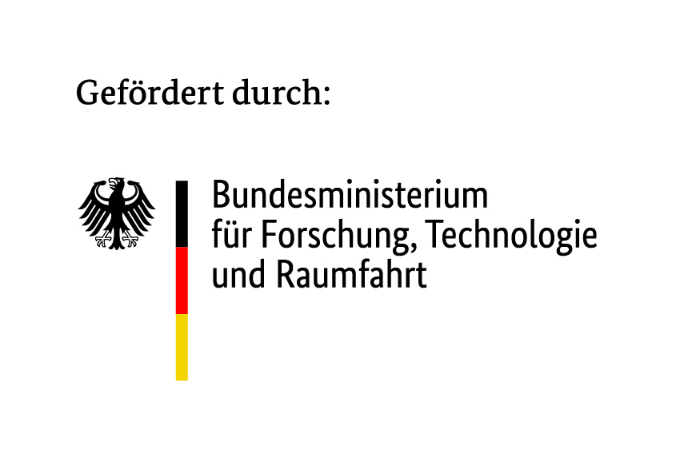

# SODaBeratungsCamp: Modul 2

Dieses Repository enthält offene Lehr-/Lerneinheiten Analyse und Strukturierung von Konservierungs- und Restaurierungsdaten am Beispiel medienarchäologischer Erschließung. Die Materialien wurden im Rahmen der [SODa-Initiative](https://sammlungen.io) entwickelt und richten sich an Forschende, Sammlungsbetreuende, Sammlungsleitende und darüber hinaus.

## Mitwirkende

Canan Hastik, https://orcid.org/0000-0003-1729-4642

Gudrun Schwenk, https://orcid.org/0009-0002-3156-8339

---

## Inhalte

Dieses Modul beinhaltet Materialien zur Durchführung eines Präsenz Workshops als BeratungsCamp mit Kurzimpulsen zu den Themen **Metadaten und Metadatenschemata in der Konservierungs- und Restaurierungsdokumentation** in **Einheit 1**. Einheit 1 beinhaltet dabei eine Kurzvorstellung des von der NFDI4Objects-TWG "Community-Standards für kontrollierte Vokabulare und Austauschformate im Bereich der Erhaltung und Pflege des kulturellen Erbens" entwickelten **Metadatenschemas für die Dokumentation von Konservierungs- und Restaurierungsmaßnahmen (KuR-MDS)**. In **Einheit 2** folgen Kurzimpulse zur Frage wie man von einer **unstrukturierten Dokumentation konservierungs- und restaurierungsbezogener Daten zu strukturierten Daten** gelangt. Der Herausforderung wird sich anhand **medienarchäologischer Beispiele** genähert. **Einheit 3** widmet sich exemplarisch der **ereignisorientierten Erfassung von Konservierungs- und Restaurierungsmaßnahmen im WissKI des SODa Semantic Coworking-Space (SCS)**.

Die folienbasierten Kurzinputs werden ergänzt durch Gruppenarbeiten, gemeinsame Übungen, der konkreten Arbeit mit einer WissKI-Instanz und Diskussionsimpulsen, die sich didaktisch für Präsenzveranstaltungen mit einer Gruppengröße von maximal 25 Personen eignen. (z. B. *Übung: Dokumentation lesen und annotieren*)

---

## Zielgruppen

- Forschende
- Sammlungsleitende und -betreuende
- Technisches admin Personal
- Hilfskräfte
- Interessierte

---

## Hinweis zur Nachnutzung

Die Materialien können frei genutzt, adaptiert und in eigene Lehr-/Lernkontexte integriert werden. Beiträge und Weiterentwicklungen sind ausdrücklich willkommen! Bitte öffne ein Issue oder sende einen Pull Request.

Die in diesem Ordner enthaltenen Daten stehen unter der Lizenz **CC BY 4.0**  
(Creative Commons Attribution 4.0 International).

Das bedeutet: Sie dürfen die Daten frei nutzen, teilen und weiterverarbeiten, solange die Quelle genannt wird.

---

## Technische Hinweise

mediatype: Text (mit referenzierten Multimedia-Inhalten)

additional mediatype: Still Image

technical format: Markdown mit LiaScript-Erweiterungen

additional technical format: png (eingebettete Grafik), jpeg (eingebettete Grafik)

file format: .md | MIME: text/markdown

software: LiaScript

runtime environment: https://liascript.github.io

---

## Lizenz

Dieses Repository steht unter der [Creative Commons Namensnennung 4.0 International (CC BY 4.0)](https://creativecommons.org/licenses/by/4.0/deed.de)-Lizenz.  
Bitte nenne bei Verwendung die Quelle wie folgt:

> SODa-Initiative. *SODa OERs – Open Educational Resources for Semantic Data and FAIR Practices*. https://github.com/[user]/[repo], CC BY 4.0

---

## Förderhinweis

Das Projekt **SODa - Sammlungen, Objekte, Datenkompetenzen** wird durch das Bundesministerium für Forschung, Technologie und Raumfahrt (BMFTR) und die Europäische Union - NextGenerationEU gefördert.

  
  &nbsp;&nbsp;&nbsp;
  

---

## Zitationsempfehlung

Schwenk, G. A., & Hastik, C. (2026, November 30). SODaBeratungsCamp: Modul 2. Zenodo. https://doi.org/10.5281/zenodo.24584230

---

## Kontakt

Für Rückfragen oder Kooperationen:

**SODa – Sammlungen, Objekte und Datenkompetenzen**  
E-Mail: [soda@sammlungen.io](mailto:soda@sammlungen.io)  
Website: [https://sammlungen.io](https://sammlungen.io)
